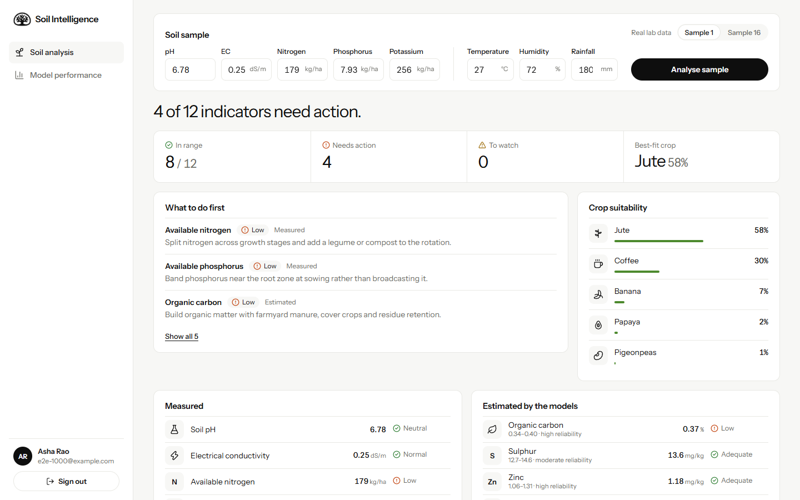
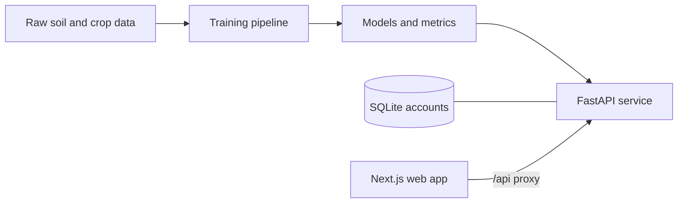

<p align="center">
  
</p>

<h1 align="center">Soil Intelligence</h1>

<p align="center">
  An ML-powered agricultural intelligence platform for soil property prediction,<br>
  crop stress assessment, and data-driven farming recommendations.
</p>

<p align="center">
  
  
  
  
  
</p>


## Overview

Laboratory soil analysis is slow and expensive, so farming decisions are often made late or without data. Soil Intelligence takes the five readings on a routine soil test and returns seven costlier lab measurements as estimates, flags nutrient and salinity stress, ranks suitable crops, and states how far each result can be trusted.



## Features

| Capability | What it does |
| --- | --- |
| **Soil property estimation** | Estimates organic carbon, sulphur, zinc, boron, iron, manganese and copper from pH, EC, N, P and K |
| **Uncertainty reporting** | Gives every estimate a 90% range and a reliability rating, and marks results close to a threshold as borderline |
| **Stress assessment** | Reads 12 indicators against agronomic bands: in range, watch, or action needed |
| **Crop suitability** | Ranks 22 crops from local climate and pH |
| **Prioritised recommendations** | Puts measured problems before estimates and asks for lab confirmation when a finding is uncertain |
| **Input safeguards** | Rejects impossible values and warns when an input is outside the training range |
| **Model transparency** | Publishes held-out test results for every model inside the dashboard |
| **Accounts** | Protects the dashboard and its data behind sign-in |

## Model performance

Soil models are scored on **44 whole fields excluded from training**. "Baseline" is the error of always predicting the training average.

| Property | Selected model | R² (unseen fields) | R² (random split) | Mean error | Baseline | 90% range hit rate |
| --- | --- | ---: | ---: | ---: | ---: | ---: |
| Organic carbon (%) | Random Forest | 0.91 | 0.92 | 0.014 | 0.047 | 90% |
| Sulphur (mg/kg) | Random Forest | 0.55 | 0.64 | 0.554 | 1.136 | 82% |
| Zinc (mg/kg) | Random Forest | 0.73 | 0.87 | 0.069 | 0.182 | 86% |
| Boron (mg/kg) | Random Forest | 0.73 | 0.78 | 0.083 | 0.203 | 84% |
| Iron (mg/kg) | Random Forest | 0.89 | 0.92 | 0.233 | 0.756 | 84% |
| Manganese (mg/kg) | Random Forest | 0.93 | 0.93 | 0.059 | 0.258 | 96% |
| Copper (mg/kg) | XGBoost | 0.86 | 0.89 | 0.040 | 0.121 | 88% |

The crop model (Random Forest) reaches 96.4% accuracy and a 0.963 macro F1 on a stratified 20% hold-out, with the correct crop in its top three for every test row. That benchmark is unusually clean, so expect lower accuracy in the field.

### Evaluation method

The soil file contains runs of near-identical consecutive samples: 257 samples collapse into 216 fields. A random split places readings of one field on both sides of the split and inflates the score, as the random-split column shows. This project therefore:

1. Infers field groups from the distance between consecutive samples.
2. Holds out 20% of fields as an independent test set.
3. Compares Ridge regression, Random Forest and XGBoost using 5-fold group cross-validation on the remaining fields.
4. Builds each 90% range from out-of-fold errors, then checks its hit rate on the test fields.
5. Refits the selected model on all fields for serving, after evaluation is complete.

## Architecture



| Layer | Technology |
| --- | --- |
| Web app | Next.js 16 (App Router), React 19, TypeScript |
| Frontend tests | Vitest (built on Vite), Testing Library |
| API | FastAPI, Pydantic, Uvicorn |
| Machine learning | scikit-learn, XGBoost, pandas, NumPy |
| Storage | SQLite |
| Backend tests | pytest |

## Getting started

**Prerequisites:** Python 3.11 or newer, and Node.js 22 or newer.

**1. Clone the repository**

```bash
git clone https://github.com/sampurnachandra97-max/idp-2026.git
cd idp-2026
```

**2. Set up the backend and train the models**

```powershell
cd backend
python -m venv .venv
.\.venv\Scripts\Activate.ps1      # macOS or Linux: source .venv/bin/activate
pip install -r requirements.txt
python -m ml.train
```

**3. Start the API** on port 8000

```bash
uvicorn app.main:app --port 8000
```

**4. Start the web app** in a second terminal

```bash
cd frontend
npm install
npm run dev
```

Open <http://localhost:3000> and sign in with any email and a password of at least 8 characters.

### Configuration

| Variable | Used by | Purpose |
| --- | --- | --- |
| `BACKEND_URL` | Web app | Address of the API. Defaults to `http://127.0.0.1:8000` |
| `SOIL_DB_PATH` | API | Location of the accounts database. Defaults to `backend/data/app.db` |
| `COOKIE_SECURE` | API | Set to `true` when serving over HTTPS |

### Font

The interface uses [Instrument Sans](https://fonts.google.com/specimen/Instrument+Sans) and is ready for [PP Mori](https://pangrampangram.com/products/mori), a licensed typeface that is not included in this repository. To use it, place `PPMori-Regular` and `PPMori-SemiBold` in `frontend/public/fonts/` as `.woff2` or `.otf` files, under a licence that covers your use.

## Testing

```bash
# Backend
cd backend
python -m pytest

# Frontend
cd frontend
npm test
npm run typecheck
```

## API

| Method | Path | Purpose | Sign-in |
| --- | --- | --- | :---: |
| `GET` | `/api/health` | Service status | |
| `POST` | `/api/auth/signup` | Create an account and start a session | |
| `POST` | `/api/auth/login` | Sign in, or start an account for a new email | |
| `POST` | `/api/auth/logout` | End the session | |
| `GET` | `/api/auth/me` | The signed-in user | Required |
| `GET` | `/api/model-card` | Evaluation results for every model | Required |
| `POST` | `/api/analyze` | Analyse one soil sample | Required |

```bash
curl -c cookies.txt -X POST http://127.0.0.1:8000/api/auth/login \
  -H "Content-Type: application/json" \
  -d '{"email":"asha@example.com","password":"a-long-password"}'

curl -b cookies.txt -X POST http://127.0.0.1:8000/api/analyze \
  -H "Content-Type: application/json" \
  -d '{"pH":6.78,"EC":0.25,"N":179,"P":7.93,"K":256,"temperature":27,"humidity":72,"rainfall":180}'
```

Units: EC in dS/m; N, P and K in kg/ha; temperature in °C; humidity in %; rainfall in mm. Interactive documentation is available at <http://127.0.0.1:8000/docs>.

## Security

- Passwords are hashed with scrypt, and session tokens are stored only as SHA-256 digests.
- Sessions use HttpOnly, SameSite cookies that last seven days.
- Repeated failed sign-ins for an account are locked out for 15 minutes.
- Email addresses are not verified, and signing in with a new email creates an account. Add email verification before any public deployment.

## Project structure

```text
backend/
  app/            API, accounts, analysis engine and agronomic rules
  ml/train.py     Data preparation, model comparison and evaluation
  data/raw/       Source datasets
  tests/          API and behaviour tests
frontend/
  app/            Landing page, sign-in and dashboard routes
  components/     Sign-in form, analyzer and model performance views
  lib/            ASCII artwork, validation, session and shared types
docs/             README screenshots
```

## Limitations

- The soil models learned from a single district (Bareilly, India). Retrain on local data before using them elsewhere.
- Soil moisture is not modelled, because neither dataset measures it.
- Crop ranking uses climate and pH only. The benchmark's N, P and K columns are not on the same scale as lab results, so they are excluded.
- The soil dataset does not state units; kg/ha and mg/kg are assumed from the conventions of Indian soil health cards.
- Interpretation thresholds are general ratings, and local extension guidance should take precedence.
- Results are decision support and do not replace a lab report before spending on inputs.

## Data sources

- **Soil data:** [AgriNet: A Soil Fertility Dataset for Deep Learning-Based Fertilizer Recommendation in Rice Cultivation](https://data.mendeley.com/datasets/c7tr9j78td/1), Mendeley Data, DOI `10.17632/c7tr9j78td.1`, licensed under [CC BY 4.0](https://creativecommons.org/licenses/by/4.0/). Used unmodified apart from renaming the file.
- **Crop data:** the widely used Crop Recommendation benchmark, from a [public GitHub copy](https://raw.githubusercontent.com/Gladiator07/Harvestify/master/Data-processed/crop_recommendation.csv). Confirm its licence before commercial use.

## License

No licence has been chosen yet, so all rights are reserved by default. Add a `LICENSE` file before inviting others to reuse this code.
